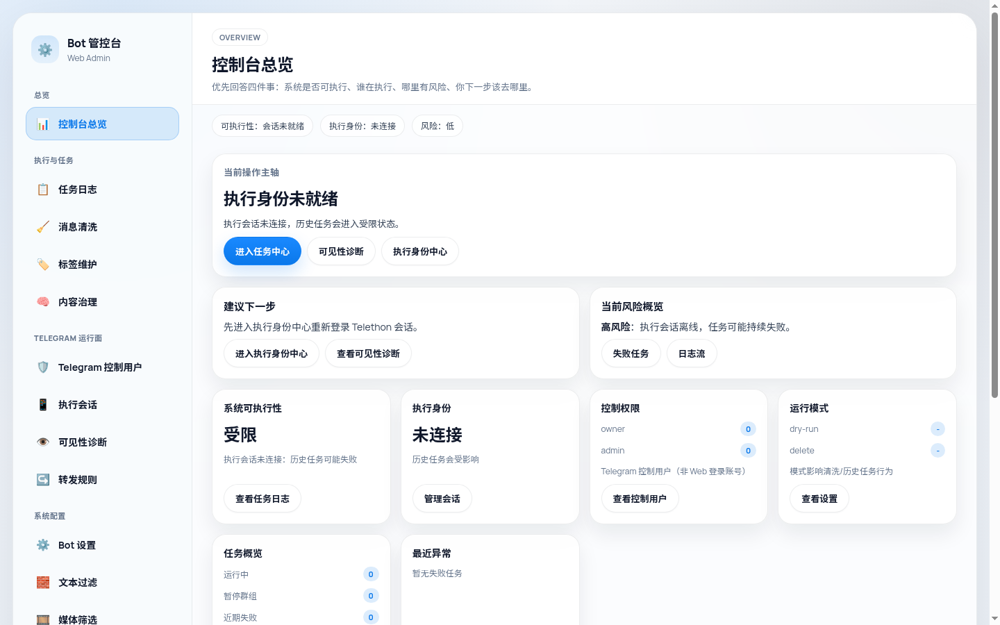
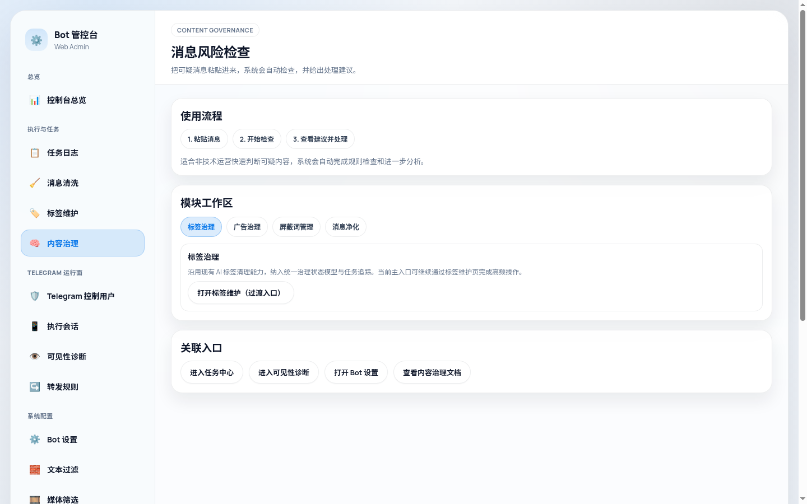
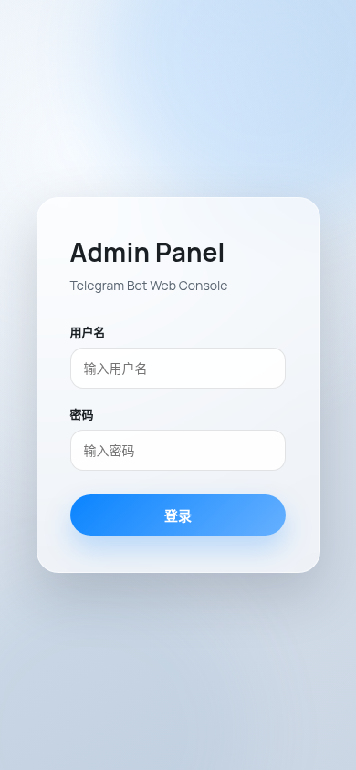

# Telegram 群组/频道媒体管理器

## Introduction

A Telegram group and channel operations tool for media deduplication, tag maintenance, and content governance with a Bot runtime and FastAPI web console.

## Problem and target users

It reduces repetitive work in media deduplication, historical content organization, and risk-content review by centralizing task state, failures, and human confirmation.

For individual operators and small teams maintaining Telegram group or channel content who need previewable, controlled cleanup workflows.

## Features and limitations

- Detects duplicate media in new Bot updates with idempotent records and a pending-delete queue.
- Uses a Telethon user session for historical scans, tag extraction, tag rebuilding, and tag catalog maintenance.
- Provides task, failure, log, session, visibility-diagnostic, and runtime-configuration views in the web console.
- Provides content-governance workflows for tag review, ad-risk analysis, blacklists, and human confirmation.
- Supports forwarding rules, text blocking, media filters, Bot operators, and AI provider settings.
- Stores task, deduplication, and runtime state in SQLite with health checks.

- The Telegram Bot API generally handles received updates; historical scans require a configured Telethon user session.
- Deletion requires the relevant administrator permission, so dry-run and human review are recommended first.
- The public repository excludes real tokens, API credentials, sessions, databases, backups, and production media; example configuration is initialization-only.
- Screenshots use an empty database and demo login state and do not represent a connected Telegram account or production data.

## Deployment

- For Docker Compose, copy .env.example to .env, prepare config.json, and run docker compose up -d.
- The published image is leduchuong/telegram_mediachanel_manager_bot:4.1.
- The web console listens on container port 8000; the compose example maps it to host port 1009 and can be adjusted.
- You can also build locally with docker build -t telegram_mediachanel_manager_bot:4.1 .

## Configuration

- Copy config.json.example to config.json and set web_admin.secret_key; change-me is only a placeholder.
- Configure bot_token, api_id, api_hash, target_chat_ids, and web_tg_session in the bot section of config.json.
- Start with bot.dry_run=true and bot.delete_duplicates=false, then enable writes only after permission and visibility checks.
- .env is reserved for container logging, compatibility paths, and the SQLite path; config.json is authoritative for business settings.

## Usage

After startup, open http://localhost:1009/login and sign in with a Web user from config.json. Confirm the Telethon session in the session center, create preview tasks from the task or content-governance views, and apply destructive changes only after review.

## Screenshots

## Security

The staging tree excludes environment files, real configuration, Telegram sessions, databases, backups, caches, and runtime logs, and passed the built-in scan, Gitleaks, and TruffleHog. Inject real credentials only in the deployment environment, use a strong web secret, restrict console exposure, and validate with dry-run before enabling deletion.
